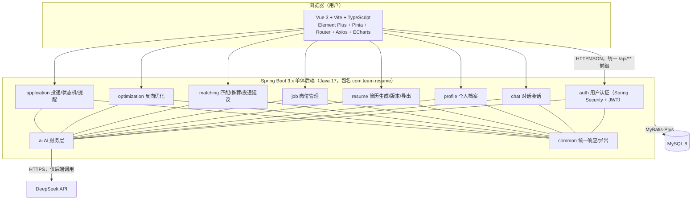

# 系统架构设计：CareerFlow-AI 智能求职助手

> 版本：v1.0（2026-11-08）｜状态：待导师架构审查

## 1. 架构总览

**架构模式：前后端分离 + 模块化单体（不是微服务）**



**为什么用模块化单体而不是微服务？**
微服务是把每个业务拆成独立运行的服务，适合几十人的大团队，但会带来服务间通信、分布式事务等大量额外复杂度。我们 3 人 14 天，单体架构开发调试简单、部署简单，按业务分包（auth/chat/profile/…）后代码边界依然清晰，比赛完全够用。这是 Chat 2 已定的决策，保持不变。

## 2. 技术栈与选型理由

| 层次 | 技术 | 理由 |
|---|---|---|
| 前端框架 | Vue 3（Composition API） | 团队既定；上手快，生态成熟 |
| 构建 | Vite | 启动快，官方推荐 |
| UI | Element Plus | 表格/表单/弹窗组件齐全，节省时间 |
| 状态/路由 | Pinia + Vue Router | Vue 3 官方组合 |
| 图表 | ECharts | 雷达图、漏斗图开箱即用 |
| HTTP | Axios | 拦截器统一处理 Token 和错误 |
| 后端 | Spring Boot 3.x + Java 17 | 团队既定；主流企业框架 |
| 持久层 | MyBatis-Plus | 比手写 SQL 省大量 CRUD 时间 |
| 数据库 | MySQL 8 | 团队既定；关系型数据（档案/版本/投递）天然适合 |
| 认证 | **Spring Security + JWT + BCrypt**（二轮审查确定） | 无 session 最简配置：放行 /api/auth/** 与 /api/health，其余走 JWT filter；注意 Spring Boot 3.x 的 SecurityFilterChain 新写法 |
| AI | DeepSeek API（OpenAI 兼容接口） | 模型 ID 以 API 账号权限为准（D1 实测确定） |
| 导出 | **PDF = OpenHTMLtoPDF；Word = Apache POI XWPF**（二轮审查确定） | Java 后端统一导出；Word 为 .docx，MIME 用 openxmlformats 类型；导出必须指定 versionId |
| 部署 | Docker Compose（Day 13-14） | 评委要求一键启动 |

**明确不引入**：Spring Cloud、Redis、RabbitMQ、Elasticsearch、多智能体框架、复杂 RAG。

## 3. 后端模块划分（com.team.resume）

| 包 | 职责 | 一句话解释 |
|---|---|---|
| auth | 注册、登录、Spring Security + JWT 签发与校验 | 管「你是谁」 |
| chat | 会话与消息管理 | 管「我们聊了什么」 |
| profile | 个人档案、项目/工作经历、证据、完整度 | 管「用户有什么经历」 |
| resume | 简历生成、版本、导出 | 管「简历怎么产出」 |
| job | 岗位与 JD 解析 | 管「岗位数据」 |
| matching | 技能矩阵、评分、推荐、投递建议 | 管「简历和岗位差多少」 |
| optimization | 反向优化任务（追问/确认/重生成） | 管「怎么补差距」 |
| application | 投递、状态机、历史、待跟进提醒 | 管「投递之后发生什么」 |
| ai | DeepSeekClient / AIService / PromptTemplate / AIResponseParser / prompt/*.txt | 所有大模型调用的唯一入口 |
| common | Result 统一返回、全局异常、工具 | 公共设施 |

**分层调用链（每个业务模块内部）：**

```
Controller（接收请求，不做业务）
   ↓
Service（业务逻辑：规则、计算、状态流转）
   ↓
Mapper（数据库操作）
```

**AI 调用属于 Service 的协作能力，不是数据访问层。** 例如简历生成：ResumeService → AIService（生成文案）→ 拿到结果后 ResumeService 校验并落库 → ResumeMapper → MySQL。业务模块永远不直接发 HTTP 请求给 DeepSeek，全部通过 ai 包——将来换模型只改 ai 包。

## 4. AI 服务层设计（防编造核心）

**分工铁律：大模型负责理解和生成，Java 负责规则、计算、状态、数据。**

| 工作 | 交给谁 |
|---|---|
| 理解自然语言、抽取经历、解析 JD、生成文案/话术 | 大模型 |
| 判断字段缺失、计算匹配分数、状态机流转、版本保存、完整度 | Java |

**AI 调用规范：**
1. 所有输出要求 JSON（response_format=json_object），Prompt 中给出结构示例
2. **结构校验**（Java）：JSON 可解析、必填字段存在、枚举值合法、类型正确
3. **事实校验**（Java）：抽取结果与用户原话对照——「学过 MySQL」不得归入项目技术栈；未确认信息标记 UNCONFIRMED，不得直接写档案
4. 健壮性默认值：超时 60s、重试 1 次、失败返回 HTTP 502 + 友好提示；解析失败不落库
5. API Key 只存后端环境变量，禁止写入代码/前端/日志/Git

**ai 包目录：**

```
ai/
├── DeepSeekClient.java     # HTTP 调用封装
├── AIService.java          # 业务侧统一入口：extractProfile()/generateResume()/parseJd()/…
├── PromptTemplate.java     # 提示词加载
├── AIResponseParser.java   # 结构校验与解析
├── dto/                    # AIRequest / AIResponse
└── prompt/                 # chat-prompt.txt / extract-prompt.txt / resume-prompt.txt / jd-prompt.txt / match-prompt.txt / pitch-prompt.txt
```

## 5. 前端结构

```
frontend/src/
├── api/            # 所有后端接口请求（路径以 docs/api.md 为准，禁止自行编造）
├── assets/         # 图片、图标
├── components/     # 公共组件
├── layouts/        # 统一布局（侧边栏 + 顶栏）
├── router/         # 路由 + 守卫（JWT 校验）
├── stores/         # Pinia（用户状态）
├── utils/          # 工具
└── views/
    ├── Login/  Register/  Dashboard/
    ├── Chat/  Profile/  Resume/
    ├── Jobs/  Match/  Applications/  Analytics/
```

| 页面 | 路由 | 功能 |
|---|---|---|
| 登录/注册 | /login /register | 认证 |
| 首页 | /dashboard | 数据概览 + **主动提醒入口（待跟进数量）** |
| AI 对话 | /chat | 多轮建档 |
| 个人档案 | /profile | 经历编辑 + 完整度雷达 |
| 我的简历 | /resume | 生成、版本、导出 |
| 岗位中心 | /jobs | 岗位列表、JD |
| 匹配分析 | /match/:jobId | 技能矩阵 + 差距（点击差距项发起追问） |
| 投递管理 | /applications | 投递记录、状态更新、待跟进 |
| 反馈分析 | /analytics | 简版：投递漏斗 + 版本效果（P1） |

> 注：Chat 2 页面清单缺少 Analytics 视图目录，本设计统一为 10 个页面（Claude 优化建议 #6）。

## 6. 关键设计决策（答辩必讲）

1. **经历证据链**：每条经历记录来源（对话/手动）与确认状态（待确认/已确认），AI 只使用已确认且可追溯的信息生成简历 → 解决「AI 编造经历」
2. **简历版本永不覆盖**：每次生成保存新版本并记录生成原因；投递记录关联具体版本 → 可统计「哪版简历效果好」
3. **匹配分数可解释**：M = Σwᵢsᵢ / Σwᵢ × 100%（wᵢ 技能权重，sᵢ 满足系数），逐技能展示 MATCHED/PARTIAL/MISSING/UNCONFIRMED + 证据 → 不是黑盒百分比
4. **状态机后端强制**：投递状态流转由 Java 校验，非法流转 409，每次流转写历史
5. **反馈回流**：岗位推荐排序参考该岗位历史反馈统计（已读率/面试率），如实声明为统计启发式
6. **内容与样式分离**：简历以结构化 JSON 保存，前端/导出模板渲染 → 换模板不用重新调 AI
