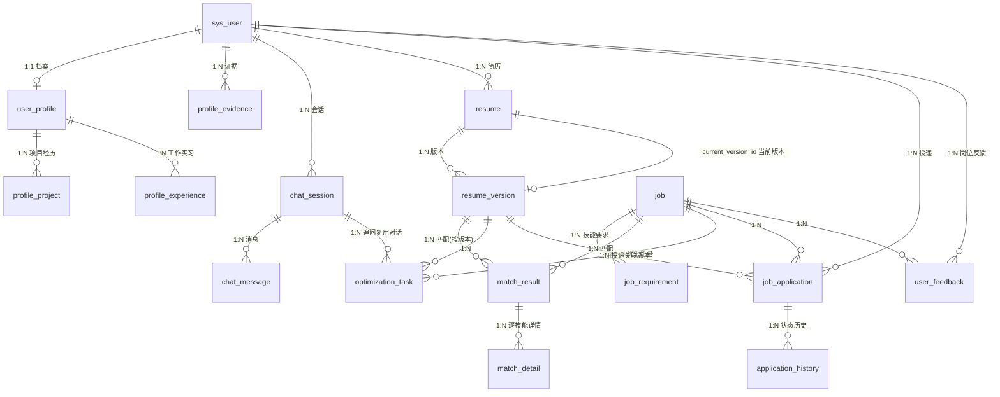

# 数据库设计：CareerFlow-AI 智能求职助手

> 版本：v1.1（2026-11-08）｜已按第二轮架构审查修订
> 数据库名：ai_resume（建表 SQL 由成员 B 在 D2 按本文件编写 database/init.sql，进入 Git）

## 1. 设计总则

- 引擎 InnoDB，字符集 utf8mb4
- 主键 BIGINT 自增（初期不引入分布式 ID）
- 时间 DATETIME；日期 DATE
- **数据库字段 snake_case，API 参数 camelCase**（映射约定见 api.md §13）
- 每张业务表都有 created_at；需要更新的表加 updated_at
- 所有查询按 user_id 做数据隔离（隔离规则见 §8）
- **本设计为 17 张表**：Chat 2 的 15 张 + profile_experience（赛题要求工作/实习经历）+ user_feedback（二轮审查新增，偏好反馈回流）
- 不建的表：profile_field（完整度规则硬编码）、reminder（提醒由 job_application 时间字段计算）、profile_education（MVP 教育经历暂存 user_profile 单条，P1 再拆）

## 2. ER 关系图



## 3. 完整字段定义

### 3.1 用户与档案

**sys_user 用户表**

| 字段 | 类型 | 约束 | 说明 |
|---|---|---|---|
| id | BIGINT | PK 自增 | |
| username | VARCHAR(50) | UNIQUE NOT NULL | 登录名 |
| password_hash | VARCHAR(255) | NOT NULL | BCrypt 加密，**禁止存明文** |
| role | VARCHAR(20) | NOT NULL DEFAULT 'USER' | ⭐ 2.0 新增：USER / ADMIN（管理端接口与岗位写权限判定） |
| email | VARCHAR(100) | | 邮箱（MVP 不做验证码） |
| created_at | DATETIME | NOT NULL | |

**user_profile 用户档案表**（MVP 教育经历暂不拆表，P1 拆 profile_education）

| 字段 | 类型 | 约束 | 说明 |
|---|---|---|---|
| id | BIGINT | PK 自增 | |
| user_id | BIGINT | UNIQUE NOT NULL | 关联 sys_user |
| real_name | VARCHAR(50) | | 姓名 |
| phone | VARCHAR(30) | | 电话 |
| school | VARCHAR(100) | | 学校 |
| major | VARCHAR(100) | | 专业 |
| degree | VARCHAR(50) | | 学历 |
| graduation_year | INT | | 毕业年份 |
| skills | JSON | | 技能列表（如 ["Java","MySQL"]） |
| target_position | VARCHAR(100) | | 目标岗位（求职意向） |
| target_city | VARCHAR(100) | | 意向城市 |
| expected_salary | VARCHAR(50) | | 期望薪资（文本，如 "8k-12k"） |
| created_at / updated_at | DATETIME | | |

### 3.2 经历与证据

**profile_project 项目经历表**

| 字段 | 类型 | 约束 | 说明 |
|---|---|---|---|
| id | BIGINT | PK 自增 | |
| profile_id | BIGINT | NOT NULL, INDEX | 关联 user_profile |
| project_name | VARCHAR(200) | NOT NULL | 项目名称 |
| role | VARCHAR(100) | | 个人角色 |
| description | TEXT | | 项目描述 |
| tech_stack | JSON | | 技术栈（该项目**真实使用**的技术） |
| start_date / end_date | DATE | | 起止时间 |
| created_at / updated_at | DATETIME | | |

**profile_experience 工作/实习经历表**（赛题明确要求收集工作/实习经历）

| 字段 | 类型 | 约束 | 说明 |
|---|---|---|---|
| id | BIGINT | PK 自增 | |
| profile_id | BIGINT | NOT NULL, INDEX | 关联 user_profile |
| company | VARCHAR(200) | NOT NULL | 公司/单位 |
| position | VARCHAR(100) | | 职位 |
| description | TEXT | | 职责描述 |
| achievements | TEXT | | 成果 |
| start_date / end_date | DATE | | 起止时间 |
| created_at / updated_at | DATETIME | | |

**profile_evidence 经历证据表**（证据链核心，二轮审查修订：增加实体关联）

| 字段 | 类型 | 约束 | 说明 |
|---|---|---|---|
| id | BIGINT | PK 自增 | |
| user_id | BIGINT | NOT NULL, INDEX | 归属用户 |
| entity_type | VARCHAR(30) | NOT NULL | ⭐ 新增：证据对应的实体类型 |
| entity_id | BIGINT | | ⭐ 新增：实体记录 ID |
| field_name | VARCHAR(100) | NOT NULL | 对应档案字段（如 skills / project.tech_stack） |
| source_type | VARCHAR(30) | NOT NULL | 原始来源类型：CHAT / MANUAL |
| source_id | BIGINT | | 原始来源记录 ID（如 chat_message.id） |
| evidence_content | TEXT | NOT NULL | 用户原始表述 |
| confirmation_status | VARCHAR(30) | NOT NULL | PENDING（待确认）/ CONFIRMED（已确认）/ REJECTED（已拒绝） |
| created_at / updated_at | DATETIME | | |

**entity_type 取值与 entity_id 语义：**

| entity_type | entity_id 指向 | 用途 |
|---|---|---|
| PROFILE | user_profile.id | 基础信息、教育经历、求职意向等档案字段 |
| SKILL | user_profile.id（field_name=skills 定位） | 技能（技能存 JSON 无独立表） |
| PROJECT | profile_project.id | 项目经历（未创建实体前为 NULL，确认时补填） |
| EXPERIENCE | profile_experience.id | 工作/实习经历（同上） |

> ⚠️ 多态关联无法用普通外键保证完整性，**后端必须校验证据与实体的归属**（user_id 一致）。
> ⚠️ 未确认的抽取数据**只存在于 profile_evidence（PENDING）**，绝不进入 profile 表；用户确认后才落实体表。

### 3.3 对话

**chat_session 对话会话表**

| 字段 | 类型 | 说明 |
|---|---|---|
| id | BIGINT PK | |
| user_id | BIGINT NOT NULL, INDEX | 归属用户 |
| title | VARCHAR(200) | 会话名称 |
| status | VARCHAR(30) | ACTIVE / CLOSED |
| created_at / updated_at | DATETIME | |

**chat_message 对话消息表**

| 字段 | 类型 | 说明 |
|---|---|---|
| id | BIGINT PK | |
| session_id | BIGINT NOT NULL, INDEX | 关联会话 |
| role | VARCHAR(20) NOT NULL | USER / ASSISTANT |
| content | TEXT NOT NULL | 消息内容 |
| created_at | DATETIME NOT NULL | |

### 3.4 简历

**resume 简历主体表**（二轮审查修订：增加当前版本指针）

| 字段 | 类型 | 说明 |
|---|---|---|
| id | BIGINT PK | |
| user_id | BIGINT NOT NULL, INDEX | 归属用户 |
| resume_name | VARCHAR(100) | 简历名称 |
| current_version_id | BIGINT | ⭐ 新增：当前版本 ID，NULL 表示尚无版本。省去每次按版本号排序查询 |
| created_at / updated_at | DATETIME | |

**resume_version 简历版本表**（⭐ 永不覆盖；二轮审查修订：并发约束）

| 字段 | 类型 | 说明 |
|---|---|---|
| id | BIGINT PK | |
| resume_id | BIGINT NOT NULL, INDEX | 关联简历主体 |
| version_number | INT NOT NULL | 版本号（同一 resume 内递增） |
| content | JSON NOT NULL | 结构化简历内容（personalInfo/education/skills/projects/experiences/selfEvaluation） |
| generation_reason | VARCHAR(200) | 生成原因（如 初次生成 / 岗位定向 / 补充SpringBoot练习） |
| created_at | DATETIME NOT NULL | |

- **UNIQUE(resume_id, version_number)**：防两个并发请求生成同一个版本号
- **生成新版本必须在一个事务中完成**：① `SELECT … FOR UPDATE` 锁定 resume 主记录 ② 取 max(version_number)+1 ③ INSERT 新版本 ④ UPDATE resume.current_version_id ⑤ 提交。旧版本禁止修改。

### 3.5 岗位与匹配

**job 岗位表**

| 字段 | 类型 | 说明 |
|---|---|---|
| id | BIGINT PK | |
| company | VARCHAR(200) | 公司 |
| company_id | BIGINT NULL | ⭐ 2.0 新增：关联 company；旧数据为空，company 文本保留兜底 |
| position | VARCHAR(200) | 岗位名称 |
| city | VARCHAR(100) | 工作城市 |
| salary | VARCHAR(100) | 薪资（文本，如 "6k-10k"；精确数值过滤是已知限制，见 decision-record） |
| jd_content | TEXT | 原始 JD 全文 |
| source_type | VARCHAR(30) | MOCK（内置模拟）/ MANUAL（手动录入）/ OFFICIAL（官方整理）/ PLATFORM（平台录入） |
| recruitment_batch | VARCHAR(30) NULL | ⭐ 阶段 3 新增：招聘批次（秋招/春招/实习/社招） |
| recruitment_status | VARCHAR(30) | ⭐ 阶段 3 新增：OPEN 开放 / CLOSED 已结束 / SOON 即将开始，默认 OPEN |
| created_by | BIGINT NULL | ⭐ 2.0 新增：创建者用户 ID；系统/种子数据为空 |
| visibility | VARCHAR(20) | ⭐ 2.0 新增：PUBLIC / PRIVATE，默认 PUBLIC |
| external_url | VARCHAR(500) | 外部招聘页面跳转链接（可空） |
| created_at / updated_at | DATETIME | |

**job_requirement 岗位技能要求表**

| 字段 | 类型 | 说明 |
|---|---|---|
| id | BIGINT PK | |
| job_id | BIGINT NOT NULL, INDEX | 关联岗位 |
| skill | VARCHAR(100) NOT NULL | 技能名（由 JD 解析生成，人工可改） |
| importance | VARCHAR(30) NOT NULL | REQUIRED（必备）/ PREFERRED（加分） |
| weight | DECIMAL(6,2) NOT NULL | 权重（用于匹配评分） |

**company 企业信息表**（公共数据，V2_0 建表，V3_0 增量加列）

| 字段 | 类型 | 说明 |
|---|---|---|
| id | BIGINT PK | |
| name | VARCHAR(200) NOT NULL, UNIQUE uk_name | 企业全称 |
| short_name | VARCHAR(100) | 简称 / 品牌名，前端展示优先 |
| industry | VARCHAR(100), INDEX | 行业 |
| company_type | VARCHAR(50) | 国企/民企/外企/合资 |
| scale | VARCHAR(50) | 规模区间 |
| city | VARCHAR(100), INDEX | 总部城市 |
| website | VARCHAR(500) | 企业官网 |
| recruitment_url | VARCHAR(500) | 招聘官网（综合入口） |
| campus_recruit_url | VARCHAR(500) | ⭐ 阶段 3 新增：校招入口 |
| intern_recruit_url | VARCHAR(500) | ⭐ 阶段 3 新增：实习招聘入口 |
| social_recruit_url | VARCHAR(500) | ⭐ 阶段 3 新增：社会招聘入口 |
| logo_url / description | VARCHAR(500) / TEXT | Logo 与简介 |
| status | VARCHAR(20), INDEX | ACTIVE / INACTIVE，默认 ACTIVE |
| source | VARCHAR(50) | OFFICIAL（官方整理）/ MIGRATED（历史迁移）/ SEED / ADMIN_IMPORT / MANUAL |
| source_url | VARCHAR(500) | 信息来源链接 |
| verification_status | VARCHAR(20), INDEX | ⭐ 阶段 3 新增：VERIFIED / PENDING / EXPIRED |
| last_verified_at | DATETIME | 最近一次人工核验时间 |
| created_at / updated_at | DATETIME | |

**match_result 匹配结果表**（⭐ 关联简历版本）

| 字段 | 类型 | 说明 |
|---|---|---|
| id | BIGINT PK | |
| resume_version_id | BIGINT NOT NULL, INDEX | 关联简历版本（不是 resume_id，保证匹配有版本依据） |
| job_id | BIGINT NOT NULL, INDEX | 关联岗位 |
| match_score | DECIMAL(5,2) | 匹配分数（Java 加权计算） |
| analysis_json | JSON | LLM 原始分析输出备查（结构化结果一律在 match_detail） |
| created_at | DATETIME | |

**match_detail 匹配详情表**（每项技能一条，可解释性核心）

| 字段 | 类型 | 说明 |
|---|---|---|
| id | BIGINT PK | |
| match_result_id | BIGINT NOT NULL, INDEX | 关联匹配结果 |
| skill | VARCHAR(100) NOT NULL | 技能 |
| match_status | VARCHAR(30) NOT NULL | MATCHED / PARTIAL / MISSING / UNCONFIRMED |
| evidence | TEXT | 简历中的证据（缺失则为 null） |
| suggestion | TEXT | 优化建议 |

### 3.6 优化、投递与历史

**optimization_task 反向优化任务表**

| 字段 | 类型 | 说明 |
|---|---|---|
| id | BIGINT PK | |
| user_id | BIGINT NULL | ⭐ 2.0 新增：归属用户；存量数据按对话/简历回填 |
| job_id | BIGINT | 目标岗位 |
| resume_version_id | BIGINT | 当时的简历版本 |
| chat_session_id | BIGINT | 追问复用对话页，关联会话 |
| target_skill | VARCHAR(100) | 待确认技能（如 SpringBoot） |
| question | TEXT | 追问内容 |
| status | VARCHAR(30) | WAITING_USER → ANSWER_RECEIVED → LLM_EXTRACTION → USER_CONFIRMATION → PROFILE_UPDATED → RESUME_REGENERATED |
| source | VARCHAR(30) | JD_GAP_ANALYSIS |
| created_at / updated_at | DATETIME | |

**job_application 投递记录表**（⭐ 关联简历版本；二轮审查修订：增加提醒字段）

| 字段 | 类型 | 说明 |
|---|---|---|
| id | BIGINT PK | |
| user_id | BIGINT NOT NULL, INDEX | 归属用户 |
| job_id | BIGINT NOT NULL, INDEX | 关联岗位 |
| resume_version_id | BIGINT NOT NULL, INDEX | 投递时使用的简历版本 |
| channel | VARCHAR(30) NOT NULL DEFAULT 'MANUAL' | ⭐ 2.0 新增：MANUAL / OFFICIAL_SITE / JOB_BOARD / REFERRAL |
| applied_url | VARCHAR(500) NULL | ⭐ 2.0 新增：实际投递页面链接 |
| status | VARCHAR(30) NOT NULL | 见状态机 |
| applied_at | DATETIME | 投递时间 |
| next_follow_up_at | DATETIME NULL | ⭐ 新增：下次跟进提醒时间（NULL = 用默认规则 applied/updated+3 天） |
| last_follow_up_at | DATETIME NULL | ⭐ 新增：最近一次已跟进时间 |
| updated_at | DATETIME | 最近更新（提醒计算兜底） |

**application_history 状态历史表**

| 字段 | 类型 | 说明 |
|---|---|---|
| id | BIGINT PK | |
| application_id | BIGINT NOT NULL, INDEX | 关联投递 |
| old_status / new_status | VARCHAR(30) | 状态变化 |
| note | TEXT | 状态变化备注（「HR 通知下周面试」等**状态类**反馈由此承载） |
| created_at | DATETIME | |

### 3.7 用户反馈（二轮审查新增）

**user_feedback 用户反馈表**（偏好类反馈，与状态备注区分；回流到推荐排序）

| 字段 | 类型 | 说明 |
|---|---|---|
| id | BIGINT PK | |
| user_id | BIGINT NOT NULL, INDEX | 归属用户 |
| job_id | BIGINT NOT NULL, INDEX | 反馈的岗位 |
| feedback_type | VARCHAR(30) NOT NULL | 反馈类型（见下） |
| feedback_content | VARCHAR(500) | 补充说明（可空） |
| created_at | DATETIME | |

**feedback_type 枚举与推荐回流规则（可解释规则权重，不引入机器学习）：**

| 类型 | 含义 | 推荐排序影响 |
|---|---|---|
| NOT_INTERESTED | 对该岗位不感兴趣 | 同 position 或同 company 的岗位排序系数 ×0.5（后置，不删除） |
| LOCATION_MISMATCH | 地点不合适 | 该 city 的岗位后置 |
| SALARY_MISMATCH | 薪资不合适 | 薪资低于期望的岗位后置（salary 为文本，按关键字粗略判断，见 decision-record 已知限制） |
| SKILL_ALREADY_HAVE | 技能已掌握但简历未体现 | 不影响排序；提示用户补充该技能证据（可发起反向优化任务） |

> 区分两种反馈：**状态类反馈**（已读、面试邀请等）走 PUT /api/applications/{id}/status 的 note，存 application_history；**偏好类反馈**（不感兴趣、地点薪资不符）走 POST /api/feedback，存 user_feedback。两者用途不同，不混用。

## 4. 投递状态机（二轮审查确认版）

枚举 `ApplicationStatus`：PENDING, APPLIED, READ, INTERVIEW_INVITED, INTERVIEWING, OFFERED, REJECTED, WITHDRAWN, FAILED, NO_RESPONSE

**合法转移表：**

| 当前状态 | 可转移到 |
|---|---|
| PENDING | APPLIED、WITHDRAWN（未投先撤） |
| APPLIED | READ、FAILED、WITHDRAWN、NO_RESPONSE |
| READ | INTERVIEW_INVITED、NO_RESPONSE |
| INTERVIEW_INVITED | INTERVIEWING、NO_RESPONSE |
| INTERVIEWING | OFFERED、REJECTED |
| NO_RESPONSE | READ、INTERVIEW_INVITED、REJECTED（恢复跟进） |
| OFFERED / REJECTED / WITHDRAWN / FAILED | 终态，不再流转 |

- NO_RESPONSE（长期无反馈）：MVP 由用户手动标记（不引入定时任务）；P1 加 @Scheduled 自动标记
- 每次流转**一个事务**完成：①查原状态 ②校验转移合法（不合法 → 409）③更新 job_application ④插入 application_history ⑤**重置提醒计时**（last_follow_up_at=now，next_follow_up_at=now+3 天）
- 状态只能由后端变更，前端不能任意改

## 5. 待跟进提醒规则（二轮审查确认版）

**触发条件**（GET /api/applications/follow-ups 的查询规则，Java 计算）：

```
status ∈ {APPLIED, READ, INTERVIEW_INVITED, NO_RESPONSE}
且 due ≤ now
其中 due = next_follow_up_at != NULL ? next_follow_up_at : (updated_at + 3 天)
```

**用户处理流程**（POST /api/applications/{id}/follow-up）：

1. 用户点击「已跟进」，可指定下次提醒时间
2. 后端更新 last_follow_up_at = now、next_follow_up_at = 用户指定时间（不指定默认 now+3 天）
3. 该记录从待跟进列表消失，到 next_follow_up_at 后重新出现 → **不会重复弹出已处理的提醒**
4. 状态更新（PUT status）自动重置计时（见状态机 ⑤）

不建 reminder 表，全部由 job_application 的两个时间字段计算。

## 6. 档案完整度计算规则（Java 硬编码）

6 个维度，每维度按「已满足必填项 / 必填项总数」计分，总分取平均：

| 维度 | 必填项 | 说明 |
|---|---|---|
| 基础信息 | real_name、phone | 2 项 |
| 教育经历 | school、major、degree、graduation_year | 4 项 |
| 技能信息 | skills 非空且 ≥3 条（且至少 1 条 CONFIRMED 证据） | 逻辑判断 |
| 项目经历 | ≥1 条 profile_project，且含 project_name、description、tech_stack | 逻辑判断 |
| 工作/实习经历 | ≥1 条 profile_experience，**或用户在对话中明确表示「无」**（记证据） | 学生无经历不强制 |
| 求职意向 | target_position、target_city | expected_salary 计半分 |

前端以雷达图展示（亮点一），补充信息后自动更新。

## 7. 索引与唯一约束清单

| 表 | 约束/索引 |
|---|---|
| sys_user | UNIQUE(username)；INDEX(role) |
| user_profile | UNIQUE(user_id)；INDEX(user_id) |
| profile_project | INDEX(profile_id) |
| profile_experience | INDEX(profile_id) |
| profile_evidence | INDEX(user_id)、INDEX(entity_type, entity_id)、INDEX(confirmation_status) |
| chat_session | INDEX(user_id) |
| chat_message | INDEX(session_id, created_at) |
| resume | INDEX(user_id) |
| resume_version | **UNIQUE(resume_id, version_number)**；INDEX(resume_id) |
| job | INDEX(city)、INDEX(position)、INDEX(company_id)、INDEX(created_by)、INDEX(visibility) |
| job_requirement | INDEX(job_id) |
| match_result | INDEX(resume_version_id)、INDEX(job_id) |
| match_detail | INDEX(match_result_id) |
| optimization_task | INDEX(chat_session_id)、INDEX(status)、INDEX(user_id) |
| job_application | INDEX(user_id, status)、INDEX(next_follow_up_at)、INDEX(channel) |
| application_history | INDEX(application_id, created_at) |
| user_feedback | INDEX(user_id)、INDEX(job_id) |

## 8. 数据隔离规则（所有接口必须校验）

| 表 | 归属判定链 |
|---|---|
| user_profile / profile_project / profile_experience | 经 profile_id → user_profile.user_id 校验 |
| profile_evidence | 直接 user_id 校验（实体表同校验） |
| chat_session | user_id 校验 |
| chat_message | 经 session_id → chat_session.user_id 校验 |
| resume / resume_version | resume 经 user_id；version 经 resume_id → resume.user_id |
| job / job_requirement | 读：`visibility='PUBLIC' OR created_by=当前用户`（ADMIN 全量）；写：仅 ADMIN 或岗位创建者 |
| match_result / match_detail | 经 resume_version_id → resume.user_id |
| optimization_task | 优先 user_id 校验；历史数据 user_id 为空时回退 chat_session_id → chat_session.user_id |
| `job_application` | user_id 校验；resume_version/job 存在性校验 |
| application_history | 经 application_id → job_application.user_id |
| user_feedback | user_id 校验 |
| resume_draft | user_id 校验；resume_id 存在时经 resume.user_id 二次校验 |
| resume_edit_history | user_id 校验；draft_id / resume_id 存在时同样校验归属 |

**禁止仅凭前端传来的 ID 查询或修改任何数据。**

## 9. 数据库铁律（写进 CLAUDE.md）

1. 每张业务表都有 created_at，需要更新的表加 updated_at
2. 用户数据必须通过 user_id 隔离，禁止仅凭前端传来的 ID 查询他人数据
3. 所有简历版本保留，禁止覆盖旧版本；生成版本必须走锁定事务 + 唯一约束
4. 投递记录与匹配结果必须关联具体的简历版本
5. 用户原始经历与 AI 优化后的文案分开保存（原始在 profile_* 与 profile_evidence，优化文案在 resume_version.content，证据可追溯）
6. 未确认的抽取数据只存在于 profile_evidence（PENDING），确认后才落实体表

## 10. 2.0 增量变更（迁移脚本 `database/migration/V2_0__base.sql`）

> 完整设计见 `docs/2.0/database-migration.md`。本脚本只做增量，可重复执行，不删除/不重命名旧表。

**新增表**

| 表 | 定位 | 归属 |
|---|---|---|
| `resume_draft` | 八步创建草稿，可覆盖，与不可变 `resume_version` 分离 | `user_id` |
| `resume_edit_history` | 区块级 AI/人工修改历史，确认后才 APPLIED | `user_id` |
| `document_asset` | 原始 DOCX / JD 截图 / 证件照，下载需鉴权 | `user_id` |
| `company` | 200+ 企业信息库（公共数据） | 无 user_id，写仅 ADMIN |
| `company_recruitment` | 企业秋招/春招/实习/社招信息（公共数据） | 经 `company_id`，写仅 ADMIN |

**新增列**

| 表 | 列 | 用途 |
|---|---|---|
| `sys_user` | `role` | USER / ADMIN，默认 USER |
| `job` | `company_id`、`created_by`、`visibility` | 企业关联与私有岗位可见性 |
| `resume` | `source_document_asset_id` | 原始简历文件（第一阶段保留文件 + 新版本导出） |
| `job_application` | `channel`、`applied_url` | 投递渠道记录，不支持自动投递 |
| `optimization_task` | `user_id` | 直接归属，避免只靠对话间接追溯 |

**新增表字段**

`resume_draft`（八步草稿，可覆盖，与不可变 `resume_version` 分离）

| 列 | 类型 | 说明 |
|---|---|---|
| `user_id` | BIGINT NOT NULL | 归属用户，所有读写按此隔离 |
| `resume_id` | BIGINT NULL | 关联 `resume`；新建草稿可为空，首次生成后回填 |
| `draft_name` | VARCHAR(100) NULL | 草稿名称 |
| `current_step` | TINYINT NOT NULL DEFAULT 1 | 当前步骤 1-8，用于中断恢复 |
| `content` | JSON NOT NULL | 八步表单完整内容快照（含 `fieldSources` 来源追溯） |
| `revision` | INT NOT NULL DEFAULT 1 | 乐观锁版本，每次保存 +1；冲突返回 409 |
| `status` | VARCHAR(20) NOT NULL DEFAULT 'DRAFT' | DRAFT / COMPLETED / ABANDONED |
| `last_saved_at` | DATETIME NOT NULL | 最近自动保存时间，用于「继续编辑」排序 |
| `created_at` / `updated_at` | DATETIME NOT NULL | 时间戳 |

索引：`idx_user_status(user_id, status)`、`idx_resume_id(resume_id)`、`idx_last_saved_at(last_saved_at)`。

`resume_edit_history`（区块级候选修改历史，确认后才 APPLIED）

| 列 | 类型 | 说明 |
|---|---|---|
| `user_id` | BIGINT NOT NULL | 归属用户 |
| `resume_id` / `draft_id` / `base_version_id` | BIGINT NULL | 关联简历、草稿或正式版本 |
| `section_key` | VARCHAR(50) NOT NULL | BASIC / EDUCATION / PROJECT / SKILL / EXPERIENCE / SELF_EVALUATION / SOFT / PHOTO |
| `before_content` / `after_content` | JSON NULL | 修改前内容与 AI 候选内容 |
| `source` | VARCHAR(20) NOT NULL | AI / MANUAL |
| `status` | VARCHAR(20) NOT NULL DEFAULT 'PENDING' | PENDING / APPLIED / REJECTED |
| `warnings` | TEXT NULL | JSON 数组：事实校验回退/降级提示 |
| `prompt_summary` | VARCHAR(500) NULL | 修改意图摘要；STAR 候选以 `STAR:{experienceId}` 标记 |
| `model` | VARCHAR(50) NULL | 使用的模型，便于追溯 |
| `created_at` / `applied_at` | DATETIME NULL | 创建与确认时间 |

索引：`idx_user_resume(user_id, resume_id)`、`idx_draft_status(draft_id, status)`、`idx_base_version(base_version_id)`、`idx_created_at(created_at)`。

**草稿写入规则**

1. 草稿只存编辑态，可覆盖；生成正式版本时才转成不可变 `resume_version`。
2. 保存必须带 `revision`，`UPDATE ... WHERE revision = ?` 命中 0 行时区分 404 / 403 / 409（`revision` 过期或草稿已结束）。
3. `content` 内每条教育/经历/项目都保存 `fieldSources`，逐字段记录来源（`MANUAL` / `PROFILE` / `AI_CONFIRMED`），生成版本时整体写入 `resume_version.content.sourceTrace`。

**回填规则**

- `optimization_task.user_id`：先经 `chat_session.user_id`，再经 `resume_version → resume.user_id` 回填；只更新 `user_id IS NULL` 的行。
- 其余新增列一律可空或带默认值，存量数据行为不变（`visibility=PUBLIC`、`channel=MANUAL`、`role=USER`）。

**执行方式**

```bash
mysql -u <user> -p ai_resume < database/migration/V2_0__base.sql   # 可重复执行
mysql -u <user> -p ai_resume < database/migration/V2_0__admin.sql  # 按需提升管理员
```

### 10.1 阶段 3 增量（迁移脚本 `database/migration/V3_0__company.sql`）

在 V2_0 之后执行，只有加列/加索引，可重复执行：

| 表 | 列 | 说明 |
|---|---|---|
| `company` | `campus_recruit_url`、`intern_recruit_url`、`social_recruit_url` | 校招 / 实习 / 社招入口，均为企业官方公开链接 |
| `company` | `verification_status`（默认 PENDING）+ `idx_verification` | 链接核验状态：VERIFIED / PENDING / EXPIRED |
| `job` | `company_id`（已存在则跳过）+ `idx_company_id` | 关联企业库；存量数据保持空值，`job.company` 文本兜底 |
| `job` | `recruitment_batch`、`recruitment_status`（默认 OPEN）+ `idx_batch_status` | 招聘批次与状态，支持列表筛选与过期标记 |

种子数据：`database/migration/V3_0__company_seed.sql`，共 251 家企业（超过 200 家验收线），
`source='SEED'` 或 `MIGRATED`，`verification_status='PENDING'`，由管理员后续逐条核验。

```bash
mysql -u <user> -p ai_resume < database/migration/V3_0__company.sql       # 可重复执行
mysql -u <user> -p ai_resume < database/migration/V3_0__company_seed.sql  # 导入 251 家企业
```
